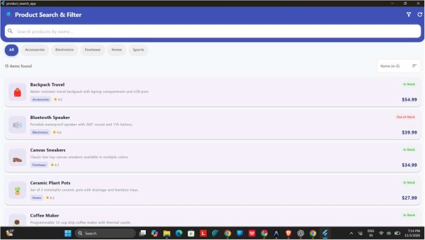
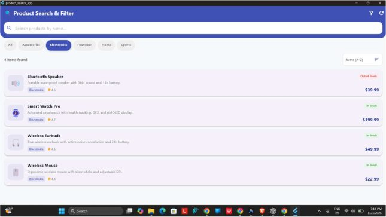

# Ex. No. 3: Interactive Product Search and Filter App

Kevin Kattakayam | URK23CS7081  
24CS2016 - Building Applications using Flutter  
Date of Exercise: 2026-08-24  
Github Code Link (Keep as public): https://github.com/Kevin-Kattakayam/exp3

## Aim

To create a Flutter product browser that searches product information and combines category, price, availability, and sorting controls.

## Description

The screen filters the product data by a case-insensitive name or description search, selected category, price range, and optional in-stock status. Users can choose sorting by name, price, or rating, open or close the filter panel, and reset the controls. The product model and reusable widgets provide the values and visual cards shown in the results.

## Program

### lib/main.dart

```dart
import 'package:flutter/material.dart';
import 'screens/product_search_screen.dart';

void main() {
  runApp(const ProductSearchApp());
}

/// Root widget of the Product Search and Filter Application.
class ProductSearchApp extends StatelessWidget {
  const ProductSearchApp({super.key});

  @override
  Widget build(BuildContext context) {
    return MaterialApp(
      title: 'Product Search & Filter',
      debugShowCheckedModeBanner: false,
      theme: ThemeData(
        colorSchemeSeed: Colors.indigo,
        useMaterial3: true,
      ),
      home: const ProductSearchScreen(),
    );
  }
}
```

### lib/data/product_data.dart

```dart
import '../models/product.dart';

/// Predefined list of products for the application.
class ProductData {
  static const List<Product> products = [
    Product(
      id: '1',
      name: 'Wireless Earbuds',
      description: 'True wireless earbuds with active noise cancellation and 24h battery.',
      price: 49.99,
      category: 'Electronics',
      emoji: '🎧',
      rating: 4.5,
      inStock: true,
    ),
    Product(
      id: '2',
      name: 'Smart Watch Pro',
      description: 'Advanced smartwatch with health tracking, GPS, and AMOLED display.',
      price: 199.99,
      category: 'Electronics',
      emoji: '⌚',
      rating: 4.7,
      inStock: true,
    ),
    Product(
      id: '3',
      name: 'Running Shoes',
      description: 'Lightweight mesh running shoes with responsive foam cushioning.',
      price: 79.99,
      category: 'Footwear',
      emoji: '👟',
      rating: 4.3,
      inStock: true,
    ),
    Product(
      id: '4',
      name: 'Leather Wallet',
      description: 'Genuine leather bifold wallet with RFID blocking technology.',
      price: 29.99,
      category: 'Accessories',
      emoji: '👛',
      rating: 4.1,
      inStock: false,
    ),
    Product(
      id: '5',
      name: 'Yoga Mat',
      description: 'Eco-friendly non-slip yoga mat with alignment guides.',
      price: 24.99,
      category: 'Sports',
      emoji: '🧘',
      rating: 4.8,
      inStock: true,
    ),
    Product(
      id: '6',
      name: 'Coffee Maker',
      description: 'Programmable 12-cup drip coffee maker with thermal carafe.',
      price: 45.99,
      category: 'Home',
      emoji: '☕',
      rating: 4.4,
      inStock: true,
    ),
    Product(
      id: '7',
      name: 'Desk Lamp LED',
      description: 'Adjustable LED desk lamp with 5 brightness levels and USB charging.',
      price: 34.99,
      category: 'Home',
      emoji: '💡',
      rating: 4.2,
      inStock: true,
    ),
    Product(
      id: '8',
      name: 'Bluetooth Speaker',
      description: 'Portable waterproof speaker with 360° sound and 15h battery.',
      price: 39.99,
      category: 'Electronics',
      emoji: '🔊',
      rating: 4.6,
      inStock: false,
    ),
    Product(
      id: '9',
      name: 'Sunglasses UV400',
      description: 'Polarized sunglasses with UV400 protection and lightweight frame.',
      price: 19.99,
      category: 'Accessories',
      emoji: '🕶️',
      rating: 4.0,
      inStock: true,
    ),
    Product(
      id: '10',
      name: 'Backpack Travel',
      description: 'Water-resistant travel backpack with laptop compartment and USB port.',
      price: 54.99,
      category: 'Accessories',
      emoji: '🎒',
      rating: 4.5,
      inStock: true,
    ),
    Product(
      id: '11',
      name: 'Dumbbells Set',
      description: 'Adjustable dumbbells set with non-slip grip, 5–25 lbs each.',
      price: 89.99,
      category: 'Sports',
      emoji: '🏋️',
      rating: 4.7,
      inStock: true,
    ),
    Product(
      id: '12',
      name: 'Ceramic Plant Pots',
      description: 'Set of 3 minimalist ceramic pots with drainage and bamboo trays.',
      price: 27.99,
      category: 'Home',
      emoji: '🪴',
      rating: 4.3,
      inStock: true,
    ),
    Product(
      id: '13',
      name: 'Canvas Sneakers',
      description: 'Classic low-top canvas sneakers available in multiple colors.',
      price: 34.99,
      category: 'Footwear',
      emoji: '👞',
      rating: 4.1,
      inStock: true,
    ),
    Product(
      id: '14',
      name: 'Wireless Mouse',
      description: 'Ergonomic wireless mouse with silent clicks and adjustable DPI.',
      price: 22.99,
      category: 'Electronics',
      emoji: '🖱️',
      rating: 4.4,
      inStock: true,
    ),
    Product(
      id: '15',
      name: 'Water Bottle',
      description: 'Insulated stainless steel bottle — keeps cold 24h, hot 12h.',
      price: 18.99,
      category: 'Sports',
      emoji: '🧴',
      rating: 4.6,
      inStock: false,
    ),
  ];

  /// Returns unique categories from the product list.
  static List<String> get categories =>
      products.map((p) => p.category).toSet().toList()..sort();
}
```

### lib/models/product.dart

```dart
/// Model class representing a Product.
class Product {
  final String id;
  final String name;
  final String description;
  final double price;
  final String category;
  final String emoji;
  final double rating;
  final bool inStock;

  const Product({
    required this.id,
    required this.name,
    required this.description,
    required this.price,
    required this.category,
    required this.emoji,
    required this.rating,
    required this.inStock,
  });
}
```

### lib/screens/product_search_screen.dart

```dart
import 'package:flutter/material.dart';
import '../data/product_data.dart';
import '../models/product.dart';
import '../widgets/category_filter_chip.dart';
import '../widgets/price_range_slider.dart';
import '../widgets/product_card.dart';
import '../widgets/search_bar_widget.dart';
import '../widgets/sort_dropdown.dart';
import '../widgets/stock_filter_checkbox.dart';

/// Screen that provides interactive search, filtering, and sorting capabilities.
class ProductSearchScreen extends StatefulWidget {
  const ProductSearchScreen({super.key});

  @override
  State<ProductSearchScreen> createState() => _ProductSearchScreenState();
}

class _ProductSearchScreenState extends State<ProductSearchScreen> {
  final TextEditingController _searchController = TextEditingController();

  String _searchQuery = '';
  String _selectedCategory = 'All';
  String _currentSort = 'Name (A–Z)';
  bool _showInStockOnly = false;
  bool _showFiltersPanel = false;

  static const double _minPrice = 0.0;
  static const double _maxPrice = 250.0;
  RangeValues _priceRange = const RangeValues(_minPrice, _maxPrice);

  @override
  void dispose() {
    _searchController.dispose();
    super.dispose();
  }

  void _resetFilters() {
    setState(() {
      _searchController.clear();
      _searchQuery = '';
      _selectedCategory = 'All';
      _currentSort = 'Name (A–Z)';
      _showInStockOnly = false;
      _priceRange = const RangeValues(_minPrice, _maxPrice);
    });
  }

  List<Product> get _filteredAndSortedProducts {
    var list = ProductData.products.where((product) {
      // Search query filter (matches name or description)
      final matchesSearch = _searchQuery.isEmpty ||
          product.name.toLowerCase().contains(_searchQuery.toLowerCase()) ||
          product.description.toLowerCase().contains(_searchQuery.toLowerCase());

      // Category filter
      final matchesCategory =
          _selectedCategory == 'All' || product.category == _selectedCategory;

      // Price range filter
      final matchesPrice = product.price >= _priceRange.start &&
          product.price <= _priceRange.end;

      // In-stock filter
      final matchesStock = !_showInStockOnly || product.inStock;

      return matchesSearch && matchesCategory && matchesPrice && matchesStock;
    }).toList();

    // Sorting
    switch (_currentSort) {
      case 'Name (A–Z)':
        list.sort((a, b) => a.name.compareTo(b.name));
        break;
      case 'Name (Z–A)':
        list.sort((a, b) => b.name.compareTo(a.name));
        break;
      case 'Price: Low to High':
        list.sort((a, b) => a.price.compareTo(b.price));
        break;
      case 'Price: High to Low':
        list.sort((a, b) => b.price.compareTo(a.price));
        break;
      case 'Rating: High to Low':
        list.sort((a, b) => b.rating.compareTo(a.rating));
        break;
    }

    return list;
  }

  @override
  Widget build(BuildContext context) {
    final categories = ['All', ...ProductData.categories];
    final filteredList = _filteredAndSortedProducts;

    return Scaffold(
      backgroundColor: const Color(0xFFF7F8FA),
      appBar: AppBar(
        title: const Text(
          '🔍 Product Search & Filter',
          style: TextStyle(fontWeight: FontWeight.bold),
        ),
        backgroundColor: Colors.indigo,
        foregroundColor: Colors.white,
        elevation: 0,
        actions: [
          IconButton(
            icon: Icon(
              _showFiltersPanel ? Icons.filter_alt : Icons.filter_alt_outlined,
            ),
            tooltip: 'Toggle Filter Panel',
            onPressed: () {
              setState(() {
                _showFiltersPanel = !_showFiltersPanel;
              });
            },
          ),
          IconButton(
            icon: const Icon(Icons.refresh),
            tooltip: 'Reset Filters',
            onPressed: _resetFilters,
          ),
        ],
      ),
      body: Column(
        children: [
          // Header / Search Area
          Container(
            padding: const EdgeInsets.only(top: 8, bottom: 16),
            decoration: const BoxDecoration(
              color: Colors.indigo,
              borderRadius: BorderRadius.only(
                bottomLeft: Radius.circular(24),
                bottomRight: Radius.circular(24),
              ),
            ),
            child: Column(
              children: [
                ProductSearchBar(
                  controller: _searchController,
                  onChanged: (val) {
                    setState(() {
                      _searchQuery = val;
                    });
                  },
                ),
              ],
            ),
          ),

          // Collapsible filter panel
          AnimatedCrossFade(
            duration: const Duration(milliseconds: 250),
            crossFadeState: _showFiltersPanel
                ? CrossFadeState.showSecond
                : CrossFadeState.showFirst,
            firstChild: const SizedBox.shrink(),
            secondChild: Container(
              margin: const EdgeInsets.all(12),
              padding: const EdgeInsets.all(16),
              decoration: BoxDecoration(
                color: Colors.white,
                borderRadius: BorderRadius.circular(16),
                boxShadow: [
                  BoxShadow(
                    color: Colors.grey.withValues(alpha: 0.15),
                    blurRadius: 8,
                    offset: const Offset(0, 2),
                  ),
                ],
              ),
              child: Column(
                children: [
                  PriceRangeSlider(
                    currentRange: _priceRange,
                    min: _minPrice,
                    max: _maxPrice,
                    onChanged: (values) {
                      setState(() {
                        _priceRange = values;
                      });
                    },
                  ),
                  const SizedBox(height: 12),
                  Row(
                    mainAxisAlignment: MainAxisAlignment.spaceBetween,
                    children: [
                      StockFilterCheckbox(
                        showInStockOnly: _showInStockOnly,
                        onChanged: (val) {
                          setState(() {
                            _showInStockOnly = val;
                          });
                        },
                      ),
                      SortDropdown(
                        currentSort: _currentSort,
                        onChanged: (val) {
                          setState(() {
                            _currentSort = val;
                          });
                        },
                      ),
                    ],
                  ),
                ],
              ),
            ),
          ),

          const SizedBox(height: 8),

          // Horizontal category chips
          SizedBox(
            height: 42,
            child: ListView.separated(
              scrollDirection: Axis.horizontal,
              padding: const EdgeInsets.symmetric(horizontal: 16),
              itemCount: categories.length,
              separatorBuilder: (_, _) => const SizedBox(width: 8),
              itemBuilder: (context, index) {
                final cat = categories[index];
                return CategoryFilterChip(
                  label: cat,
                  isSelected: _selectedCategory == cat,
                  onTap: () {
                    setState(() {
                      _selectedCategory = cat;
                    });
                  },
                );
              },
            ),
          ),

          const SizedBox(height: 10),

          // Results Count / Active filters indicator
          Padding(
            padding: const EdgeInsets.symmetric(horizontal: 16),
            child: Row(
              mainAxisAlignment: MainAxisAlignment.spaceBetween,
              children: [
                Text(
                  '${filteredList.length} items found',
                  style: TextStyle(
                    fontSize: 14,
                    fontWeight: FontWeight.w600,
                    color: Colors.grey[700],
                  ),
                ),
                if (!_showFiltersPanel)
                  SortDropdown(
                    currentSort: _currentSort,
                    onChanged: (val) {
                      setState(() {
                        _currentSort = val;
                      });
                    },
                  ),
              ],
            ),
          ),

          const SizedBox(height: 4),

          // Products List
          Expanded(
            child: filteredList.isEmpty
                ? Center(
                    child: Column(
                      mainAxisAlignment: MainAxisAlignment.center,
                      children: [
                        Icon(
                          Icons.search_off_rounded,
                          size: 64,
                          color: Colors.grey[400],
                        ),
                        const SizedBox(height: 12),
                        Text(
                          'No products match your criteria',
                          style: TextStyle(
                            fontSize: 16,
                            fontWeight: FontWeight.w500,
                            color: Colors.grey[600],
                          ),
                        ),
                        const SizedBox(height: 8),
                        TextButton(
                          onPressed: _resetFilters,
                          child: const Text('Reset All Filters'),
                        ),
                      ],
                    ),
                  )
                : ListView.builder(
                    padding: const EdgeInsets.only(top: 6, bottom: 20),
                    itemCount: filteredList.length,
                    itemBuilder: (context, index) {
                      return ProductCard(product: filteredList[index]);
                    },
                  ),
          ),
        ],
      ),
    );
  }
}
```

### lib/widgets/category_filter_chip.dart

```dart
import 'package:flutter/material.dart';

/// A reusable category filter chip for filtering products by category.
class CategoryFilterChip extends StatelessWidget {
  final String label;
  final bool isSelected;
  final VoidCallback onTap;

  const CategoryFilterChip({
    super.key,
    required this.label,
    required this.isSelected,
    required this.onTap,
  });

  @override
  Widget build(BuildContext context) {
    return GestureDetector(
      onTap: onTap,
      child: AnimatedContainer(
        duration: const Duration(milliseconds: 200),
        padding: const EdgeInsets.symmetric(horizontal: 16, vertical: 8),
        decoration: BoxDecoration(
          color: isSelected ? Colors.indigo : Colors.grey[200],
          borderRadius: BorderRadius.circular(20),
          boxShadow: isSelected
              ? [
                  BoxShadow(
                    color: Colors.indigo.withValues(alpha: 0.3),
                    blurRadius: 6,
                    offset: const Offset(0, 2),
                  ),
                ]
              : null,
        ),
        child: Text(
          label,
          style: TextStyle(
            color: isSelected ? Colors.white : Colors.grey[700],
            fontWeight: isSelected ? FontWeight.bold : FontWeight.w500,
            fontSize: 13,
          ),
        ),
      ),
    );
  }
}
```

### lib/widgets/price_range_slider.dart

```dart
import 'package:flutter/material.dart';

/// A reusable widget that shows a price range slider for filtering.
class PriceRangeSlider extends StatelessWidget {
  final RangeValues currentRange;
  final double min;
  final double max;
  final ValueChanged<RangeValues> onChanged;

  const PriceRangeSlider({
    super.key,
    required this.currentRange,
    required this.min,
    required this.max,
    required this.onChanged,
  });

  @override
  Widget build(BuildContext context) {
    return Column(
      crossAxisAlignment: CrossAxisAlignment.start,
      children: [
        Row(
          mainAxisAlignment: MainAxisAlignment.spaceBetween,
          children: [
            Text(
              'Price Range',
              style: TextStyle(
                fontSize: 13,
                fontWeight: FontWeight.w600,
                color: Colors.grey[800],
              ),
            ),
            Text(
              '\$${currentRange.start.toStringAsFixed(0)} – \$${currentRange.end.toStringAsFixed(0)}',
              style: TextStyle(
                fontSize: 13,
                fontWeight: FontWeight.bold,
                color: Colors.indigo[700],
              ),
            ),
          ],
        ),
        RangeSlider(
          values: currentRange,
          min: min,
          max: max,
          divisions: ((max - min) / 5).round(),
          activeColor: Colors.indigo,
          labels: RangeLabels(
            '\$${currentRange.start.toStringAsFixed(0)}',
            '\$${currentRange.end.toStringAsFixed(0)}',
          ),
          onChanged: onChanged,
        ),
      ],
    );
  }
}
```

### lib/widgets/product_card.dart

```dart
import 'package:flutter/material.dart';
import '../models/product.dart';

/// A reusable widget that displays a single product as a Card.
class ProductCard extends StatelessWidget {
  final Product product;

  const ProductCard({super.key, required this.product});

  @override
  Widget build(BuildContext context) {
    return Card(
      elevation: 2,
      margin: const EdgeInsets.symmetric(horizontal: 16, vertical: 6),
      shape: RoundedRectangleBorder(borderRadius: BorderRadius.circular(14)),
      child: Padding(
        padding: const EdgeInsets.all(14),
        child: Row(
          children: [
            // Product emoji icon
            Container(
              width: 64,
              height: 64,
              decoration: BoxDecoration(
                color: Colors.indigo.withValues(alpha: 0.08),
                borderRadius: BorderRadius.circular(14),
              ),
              child: Center(
                child: Text(product.emoji, style: const TextStyle(fontSize: 32)),
              ),
            ),
            const SizedBox(width: 14),

            // Product details
            Expanded(
              child: Column(
                crossAxisAlignment: CrossAxisAlignment.start,
                children: [
                  // Name + stock badge
                  Row(
                    children: [
                      Expanded(
                        child: Text(
                          product.name,
                          style: const TextStyle(
                            fontSize: 16,
                            fontWeight: FontWeight.bold,
                          ),
                        ),
                      ),
                      Container(
                        padding: const EdgeInsets.symmetric(
                            horizontal: 8, vertical: 3),
                        decoration: BoxDecoration(
                          color: product.inStock
                              ? Colors.green[50]
                              : Colors.red[50],
                          borderRadius: BorderRadius.circular(8),
                        ),
                        child: Text(
                          product.inStock ? 'In Stock' : 'Out of Stock',
                          style: TextStyle(
                            fontSize: 11,
                            fontWeight: FontWeight.w600,
                            color:
                                product.inStock ? Colors.green[700] : Colors.red[700],
                          ),
                        ),
                      ),
                    ],
                  ),
                  const SizedBox(height: 4),

                  // Description
                  Text(
                    product.description,
                    style: TextStyle(fontSize: 13, color: Colors.grey[600]),
                    maxLines: 2,
                    overflow: TextOverflow.ellipsis,
                  ),
                  const SizedBox(height: 8),

                  // Category, rating, and price row
                  Row(
                    children: [
                      // Category chip
                      Container(
                        padding: const EdgeInsets.symmetric(
                            horizontal: 8, vertical: 3),
                        decoration: BoxDecoration(
                          color: Colors.indigo.withValues(alpha: 0.1),
                          borderRadius: BorderRadius.circular(6),
                        ),
                        child: Text(
                          product.category,
                          style: TextStyle(
                            fontSize: 11,
                            color: Colors.indigo[700],
                            fontWeight: FontWeight.w600,
                          ),
                        ),
                      ),
                      const SizedBox(width: 8),

                      // Rating
                      Icon(Icons.star, size: 14, color: Colors.amber[700]),
                      const SizedBox(width: 2),
                      Text(
                        product.rating.toString(),
                        style: TextStyle(fontSize: 12, color: Colors.grey[700]),
                      ),

                      const Spacer(),

                      // Price
                      Text(
                        '\$${product.price.toStringAsFixed(2)}',
                        style: TextStyle(
                          fontSize: 17,
                          fontWeight: FontWeight.bold,
                          color: Colors.indigo[800],
                        ),
                      ),
                    ],
                  ),
                ],
              ),
            ),
          ],
        ),
      ),
    );
  }
}
```

### lib/widgets/search_bar_widget.dart

```dart
import 'package:flutter/material.dart';

/// A reusable search bar widget with a text field and clear button.
///
/// Uses a [TextEditingController] to manage the input and notifies
/// the parent via [onChanged] callback.
class ProductSearchBar extends StatelessWidget {
  final TextEditingController controller;
  final ValueChanged<String> onChanged;

  const ProductSearchBar({
    super.key,
    required this.controller,
    required this.onChanged,
  });

  @override
  Widget build(BuildContext context) {
    return Container(
      margin: const EdgeInsets.symmetric(horizontal: 16),
      decoration: BoxDecoration(
        color: Colors.white,
        borderRadius: BorderRadius.circular(14),
        boxShadow: [
          BoxShadow(
            color: Colors.grey.withValues(alpha: 0.15),
            blurRadius: 10,
            offset: const Offset(0, 2),
          ),
        ],
      ),
      child: TextField(
        controller: controller,
        onChanged: onChanged,
        decoration: InputDecoration(
          hintText: 'Search products by name...',
          hintStyle: TextStyle(color: Colors.grey[400]),
          prefixIcon: Icon(Icons.search, color: Colors.indigo[300]),
          suffixIcon: controller.text.isNotEmpty
              ? IconButton(
                  icon: Icon(Icons.clear, color: Colors.grey[400]),
                  onPressed: () {
                    controller.clear();
                    onChanged('');
                  },
                )
              : null,
          border: InputBorder.none,
          contentPadding:
              const EdgeInsets.symmetric(horizontal: 16, vertical: 14),
        ),
      ),
    );
  }
}
```

### lib/widgets/sort_dropdown.dart

```dart
import 'package:flutter/material.dart';

/// A reusable widget that displays sort options in a dropdown.
class SortDropdown extends StatelessWidget {
  final String currentSort;
  final ValueChanged<String> onChanged;

  const SortDropdown({
    super.key,
    required this.currentSort,
    required this.onChanged,
  });

  static const List<String> sortOptions = [
    'Name (A–Z)',
    'Name (Z–A)',
    'Price: Low to High',
    'Price: High to Low',
    'Rating: High to Low',
  ];

  @override
  Widget build(BuildContext context) {
    return Container(
      padding: const EdgeInsets.symmetric(horizontal: 12),
      decoration: BoxDecoration(
        color: Colors.white,
        borderRadius: BorderRadius.circular(10),
        border: Border.all(color: Colors.grey[300]!),
      ),
      child: DropdownButtonHideUnderline(
        child: DropdownButton<String>(
          value: currentSort,
          icon: Icon(Icons.sort, color: Colors.indigo[400], size: 20),
          style: TextStyle(fontSize: 13, color: Colors.grey[800]),
          items: sortOptions
              .map((s) => DropdownMenuItem(value: s, child: Text(s)))
              .toList(),
          onChanged: (value) {
            if (value != null) onChanged(value);
          },
        ),
      ),
    );
  }
}
```

### lib/widgets/stock_filter_checkbox.dart

```dart
import 'package:flutter/material.dart';

/// A reusable widget that provides a checkbox to toggle stock filter.
class StockFilterCheckbox extends StatelessWidget {
  final bool showInStockOnly;
  final ValueChanged<bool> onChanged;

  const StockFilterCheckbox({
    super.key,
    required this.showInStockOnly,
    required this.onChanged,
  });

  @override
  Widget build(BuildContext context) {
    return Row(
      children: [
        SizedBox(
          height: 24,
          width: 24,
          child: Checkbox(
            value: showInStockOnly,
            activeColor: Colors.indigo,
            onChanged: (value) => onChanged(value ?? false),
          ),
        ),
        const SizedBox(width: 8),
        GestureDetector(
          onTap: () => onChanged(!showInStockOnly),
          child: Text(
            'In stock only',
            style: TextStyle(
              fontSize: 13,
              color: Colors.grey[800],
              fontWeight: FontWeight.w500,
            ),
          ),
        ),
      ],
    );
  }
}
```

## Output Screenshots





## Result

The source code implements interactive product search, combined filtering, sorting, and reset behavior for the product list.

